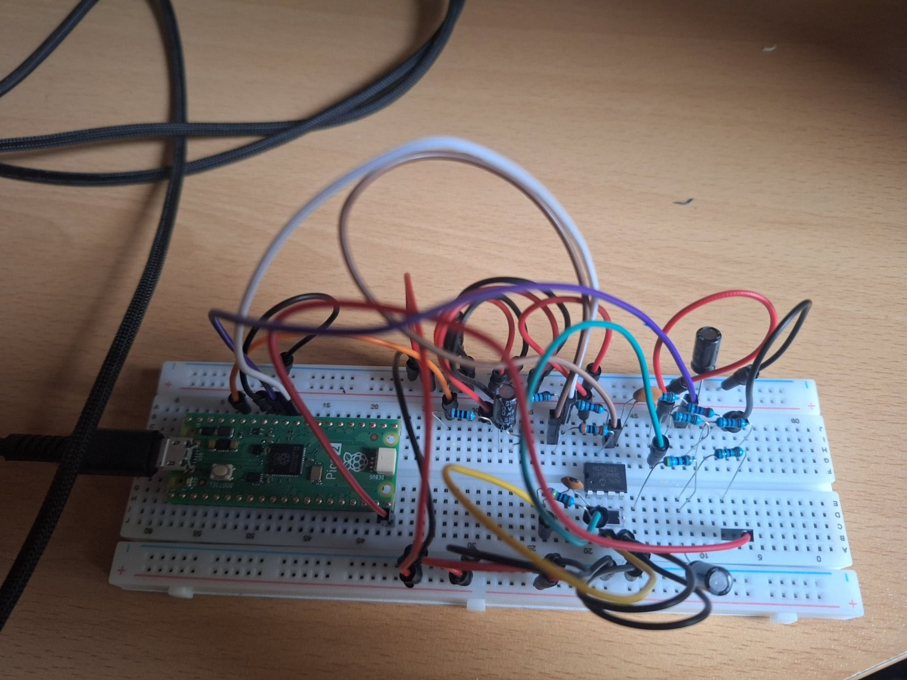
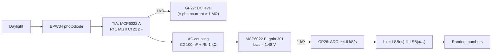
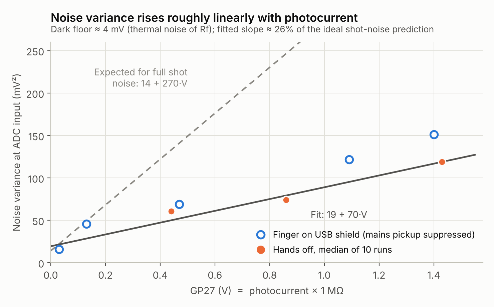
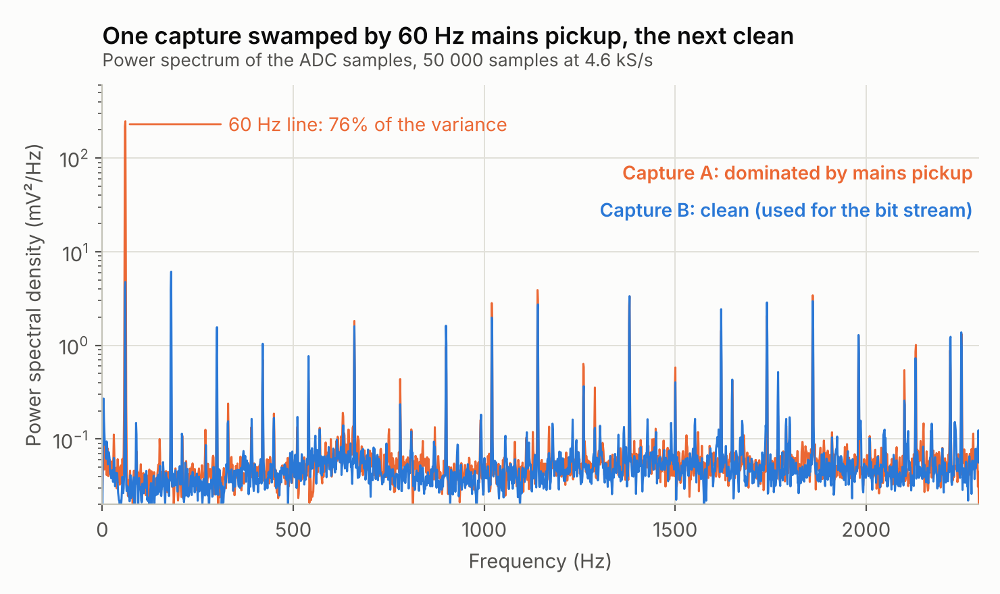
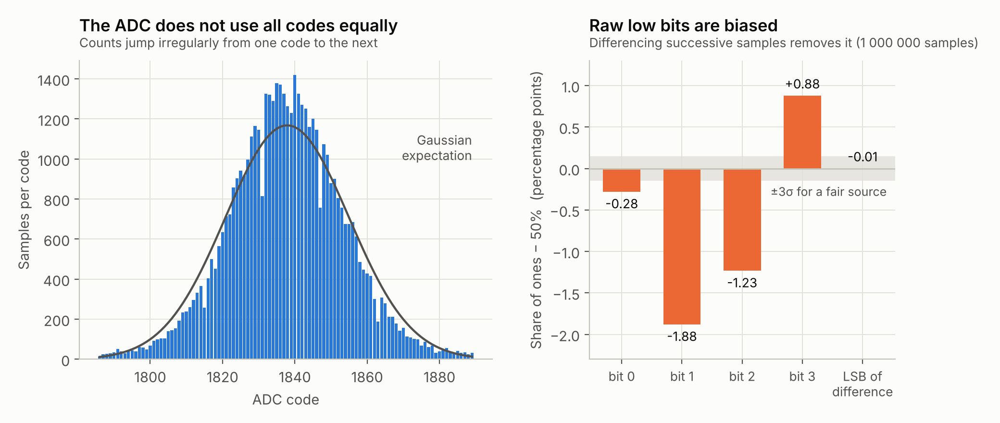
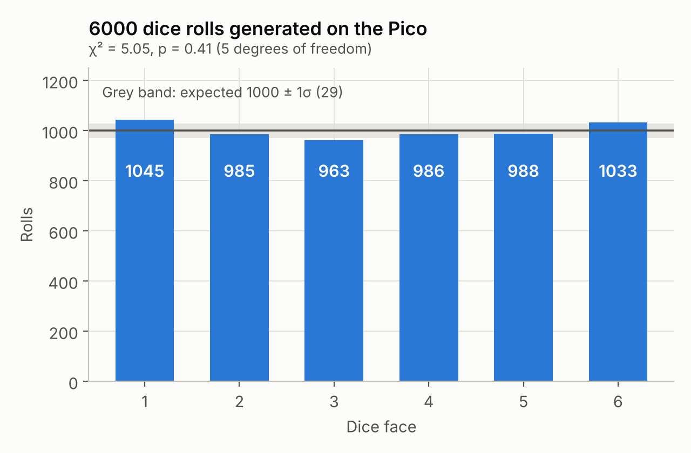

# A random number source from photodiode noise (Raspberry Pi Pico 2)

A breadboard experiment: amplify the current noise of a photodiode lit by steady daylight, sample it with the Pico's ADC, turn it into bits, and use the bits to roll dice on the board.

The measured noise is **consistent with shot noise**, and the extracted bits pass the NIST SP 800-22 tests I ran. This is a learning project, not a certified or cryptographic random number generator. See [Limitations](#limitations).



## How it works



Photons arrive at random times, so a steady photocurrent $I$ carries current noise $i_n = \sqrt{2qI\Delta f}$ (shot noise). The transimpedance stage turns it into a voltage, and the second stage amplifies the AC part by 301. The Pico samples that voltage, and the lowest bit of the difference between two consecutive samples is one random bit.

## Hardware

| Part | Value / note |
|---|---|
| Microcontroller | Raspberry Pi Pico 2 H (RP2350), MicroPython 1.29.0 |
| Op-amp | MCP6022-I/P, dual, rail-to-rail, 10 MHz GBW, DIP-8 |
| Photodiode | BPW34 |
| Stage A (transimpedance) | Rf = 1 MΩ in parallel with Cf = 22 pF, non-inverting input at analog ground |
| AC coupling | C2 = 100 nF, Rb = 1 kΩ (high-pass corner ≈ 1.6 kHz) into a bias node at Vdd/2 (R2 = R3 = 10 kΩ, Cb = 10 µF) |
| Stage B (gain) | Non-inverting, 1 + 300 kΩ / 1 kΩ = 301, with a 10 µF capacitor in series with the 1 kΩ so DC gain is 1 |
| ADC inputs | GP26 ← stage B output through 1 kΩ (the noise signal); GP27 ← stage A output through 1 kΩ (DC photocurrent monitor) |
| Supply | Pico 3V3 through 100 Ω + 10 µF to the op-amp |
| Light | Daylight through a window, room lights off |

The light source matters. A capture taken before sunrise, when the only light was presumably indoor light, measured 1.27 V rms and was unusable. I suspect lamp flicker, which the gain of 301 turns into clipping. Daylight is steady. Driving an LED from a Pico GPIO appeared to couple electrical noise into the input (the extra noise stayed the same with the light blocked), and I did not resolve that.

## Is it shot noise?

Noise was measured as $\sigma = \mathrm{std}(x_i - x_{i-1})/\sqrt{2}$ over 2000 samples, which suppresses slow drift and mains hum. The expected output variance is

$$\sigma^2 = \sigma_0^2 + G^2 R_f^2 \cdot 2qI \cdot \mathrm{ENBW}, \qquad I = V_{GP27}/R_f$$

with $G = 301$, $R_f = 1$ MΩ and an effective noise bandwidth of about 9.3 kHz, which predicts a slope of about 270 mV² per volt of GP27.



| GP27 (V) | rms noise (mV), finger on USB shield | rms noise (mV), hands off, median of 10 |
|---|---|---|
| 0.03 (dark) | 4.0 | |
| 0.13 | 6.8 | |
| 0.44 / 0.47 | 8.3 | 7.8 |
| 0.86 | | 8.6 |
| 1.09 | 11.0 | |
| 1.40 / 1.43 | 12.3 | 10.9 |

- **Dark floor:** about 4 mV (measured with a finger on the USB shield), close to the 3.7 mV expected from the thermal noise of Rf alone.
- **Light dependence:** the variance rises roughly linearly with photocurrent (fit $19 + 70V$ mV², using the dark point and the three hands-off medians). A model where the variance grows with $V^2$, as flicker-type noise would, fits clearly worse.
- **Amplitude:** the fitted slope is about 26% of the ideal prediction. I could not explain the gap.
- **Touching the board:** resting a finger on the Pico's USB shield removes most mains pickup, but the finger-on points at bright light sit about 30% above the hands-off fit in variance (about 13% in rms), so touching seems to add some noise of its own.
- **Pickup:** hands off at low light, the noise was 71–91 mV at GP27 = 0.14 V and 19–48 mV at 0.19 V, versus 7 mV with a finger on the shield. The input node has high impedance and picks up the environment.

## Interference



One capture was dominated by a 60 Hz line (33 mV peak, 76% of the variance). During it the DC level at the ADC input (the bias node) sat at 0.886 V and drifted upward at about 3 mV/s, where it normally holds 1.48 V. I suspect a poor contact in the bias network, but I did not prove it. The next capture, with the bias stable, was clean.

The clean capture (50 000 samples) has $\sigma$ = 13.8 mV, lag-1 autocorrelation 0.03, a white floor of about 11 mV, and small spurs at odd multiples of 60 Hz that carry roughly a third of the variance. Its tails are heavier than Gaussian (0.23% of samples beyond 4σ, against 0.006% expected). In the 1 000 000-sample capture, 3 of 20 segments contained bursts of interference (17–20 mV against 13.5–15 mV).

## From noise to bits



The Pico's ADC has uneven code widths, so its raw low bits are biased (bit 1 is 1 in only 48.1% of samples). Taking the lowest bit of the difference between consecutive samples removes the bias:

```
bit = LSB(x[i]) XOR LSB(x[i-1])      # 49.995% ones over 999 999 bits
```

This gives one bit per sample, about 4.6 kbit/s. Using the two lowest bits of the difference passed the basic checks I ran (about 9 kbit/s) but did not go through the full battery.

## Statistical tests

NIST SP 800-22 on 999 999 bits (one sequence). The `nistrng` library reported failures on a numpy PRNG control as well, so I re-implemented the failing tests and checked them against that control first.

| Test | p-value |
|---|---|
| Monobit | 0.913 |
| Frequency within block | 0.109 |
| Runs | 0.106 |
| Longest run of ones | 0.604 |
| Binary matrix rank | 0.593 |
| Discrete Fourier transform | 0.704 |
| Serial (m = 10) | 0.311, 0.633 |
| Serial (m = 16) | 0.222, 0.208 |
| Approximate entropy (m = 10) | 0.230 |
| Maurer's universal (L = 7) | 0.934 |
| Cumulative sums (forward, backward) | 0.270, 0.332 |
| Random excursions (smallest of 8 states) | 0.329 |
| Random excursions variant (smallest of 18) | 0.196 |
| Non-overlapping template (148 templates) | smallest 0.004, 3 below 0.01 (about 1.5 expected), uniformity 0.80 |

Other checks: the ones fraction in each 50 000-sample segment stays within 49.5–50.4%, and the most-common-value min-entropy estimate is 0.958 bits per bit at 99% confidence (limited by sample size). Bit autocorrelation shows one weak outlier at lag 78 samples ($|z|$ = 4.3, $r \approx 0.004$), which is the period of 60 Hz at this sampling rate.

## Demo: rolling dice



6000 rolls on the Pico gave 1045, 985, 963, 986, 988 and 1033 for faces 1 to 6 ($\chi^2$ = 5.05, p = 0.41, 5 degrees of freedom). This is one run of `roll_dice()`; a second run gave 987, 1036, 975, 980, 990 and 1032 ($\chi^2$ = 3.61).

## Code

Capture one million samples (the low 8 bits of each) to a file on the Pico, about 4 minutes:

```python
from machine import ADC
from array import array
import time

o = ADC(26)
g = ADC(27)
N = 50000

def read_gp27():
    return sum(g.read_u16() for _ in range(200)) / 200 / 65535 * 3.3

def capture(nc=20):
    a = array('H', (0 for _ in range(N)))
    k = 3.3 / 4095 * 1000
    kq = []
    v0 = read_gp27()
    with open('lon.bin', 'wb') as f:
        for c in range(nc):
            for i in range(N):
                a[i] = o.read_u16() >> 4
                time.sleep_us(200)
            f.write(bytes(x & 255 for x in a))
            d = [a[i] - a[i - 1] for i in range(1, 4000)]
            kq.append(round((sum(x * x for x in d) / len(d) / 2) ** 0.5 * k, 1))
    print('GP27 start/end:', round(v0, 2), round(read_gp27(), 2))
    print('noise per segment (mV):', kq)
```

Random numbers on the board:

```python
prev = o.read_u16() >> 4

def rand_bit():
    global prev
    time.sleep_us(200)
    x = o.read_u16() >> 4
    b = (x ^ prev) & 1
    prev = x
    return b

def rand_int(n):
    """Uniform integer in [0, n) by rejection sampling."""
    k = 0
    while (1 << k) < n:
        k += 1
    while True:
        v = 0
        for _ in range(k):
            v = (v << 1) | rand_bit()
        if v < n:
            return v

def print_numbers(count=10, upper=100):
    print('Random integers in [0, %d):' % upper)
    print([rand_int(upper) for _ in range(count)])

def roll_dice(rolls=6000):
    counts = [0] * 6
    for _ in range(rolls):
        counts[rand_int(6)] += 1
    expected = rolls / 6
    chi2 = sum((c - expected) ** 2 / expected for c in counts)
    print('Rolled dice %d times' % rolls)
    for face in range(6):
        print('  face %d: %d' % (face + 1, counts[face]))
    print('Chi-square: %.2f (5 degrees of freedom, fair if < 11.07)' % chi2)
```

Call `print_numbers()` for ten random integers from 0 to 99, or `roll_dice()` for the dice test.

The same code is in [`capture.py`](capture.py) and [`rng.py`](rng.py). Copy either file to the Pico, or open it in Thonny and run it.

## Limitations

- **Not a certified or cryptographic generator.** There is no health test running on the device and no cryptographic conditioning of the bits.
- **One sequence.** The NIST results come from a single 1 million bit sequence, not the many-sequence procedure, and I did not run an SP 800-90B entropy assessment.
- **Statistics do not prove the source.** Passing the tests shows the bits look random. That the noise is shot noise rests on the measurements above: the dark floor, and the roughly linear rise of the variance with photocurrent.
- **Open question.** The light-dependent noise is about a quarter of the ideal shot-noise power, and I do not know why.
- **Sensitive to the environment.** Mains pickup, flickering lights and loose breadboard contacts all showed up in the data. The light source (daylight) is not controlled.

## What I learned

- A split power rail on the breadboard and a loose resistor leg were each slow to find. Check the rails first and press every leg.
- A finger on the USB shield is a quick test for pickup: if the noise drops, the interference is coming from outside the circuit.
- Look at the spectrum before trusting a noise number. A single 60 Hz line was most of the "noise" in one capture.
- The Pico's ADC low bits are biased, so differencing consecutive samples (or hashing) is needed before using them.

## Possible next steps

- A steady, battery-powered LED as the light source, electrically isolated from the circuit.
- Shielding the photodiode input.
- A hash-based conditioner and an SP 800-90B assessment.
- On-device health tests.
